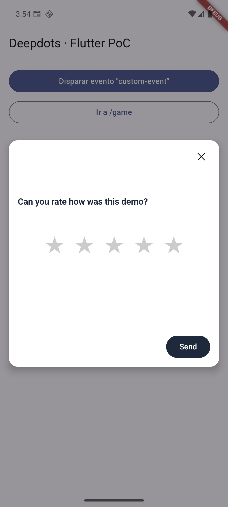
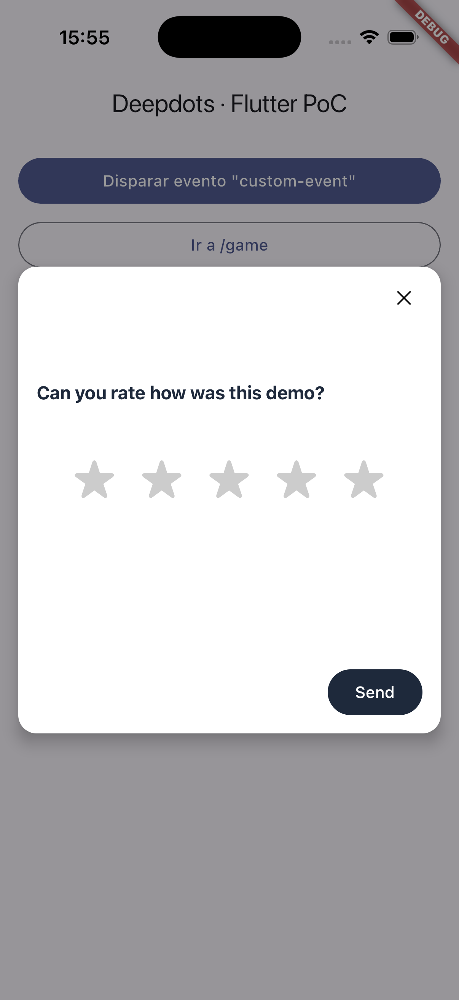

# deepdots_popups (prueba de concepto)

Plugin de Flutter que envuelve el SDK nativo de Deepdots (KMP, repo
`deepdots-popup-mobile-native-sdk`) para Android e iOS. No reimplementa lógica: la API de Dart
traduce cada llamada a `DeepdotsPopups` nativo por un `MethodChannel` y reenvía sus eventos.

**Estado: beta (MF-3270).** Usa el SDK nativo **0.7.6** publicado: Maven Central
(`com.deepdots.sdk:shared-android`) en Android y el paquete `MagicFeedback/DeepdotsSDK-SPM` en iOS
(SPM, o con CocoaPods el podspec descarga el mismo XCFramework y comprueba su sha256). La versión
nativa se cambia en `android/build.gradle.kts`, `ios/deepdots_popups/Package.swift` y
`ios/deepdots_popups.podspec` (versión y sha256), siempre las tres a la vez.

## Uso

```dart
void main() {
  WidgetsFlutterBinding.ensureInitialized();
  DeepdotsPopups.init(publicKey: '…', userId: 'user-123', language: 'da');
  runApp(MaterialApp(
    navigatorObservers: [DeepdotsNavigatorObserver()], // setPath automático
    routes: {...},
  ));
}

DeepdotsPopups.triggerEvent('general-survey');
DeepdotsPopups.events.listen((e) => print(e)); // popup_shown, popup_clicked, survey_completed
```

El ciclo de vida (`onForeground`/`onBackground`) se conecta solo con `AppLifecycleListener`,
usando `hide`/`show` y no `inactive`, porque en el SDK nativo `onBackground()` cierra la sesión.

Control manual, idioma y opciones de `init`:

```dart
DeepdotsPopups.init(
  publicKey: '…',
  userId: 'user-123',
  renderChrome: false,            // sin scrim ni tarjeta: el host pone el marco
  showProgressBar: true,          // null = lo que diga el survey en la plataforma
  metadata: {'plan': 'pro'},      // nulos fuera; `userId` gana sobre metadata['userId']
);
DeepdotsPopups.show('survey-id', 'product-id', {'source': 'banner'}); // sin triggers ni segmentación
DeepdotsPopups.showByPopupId('popup-id');
DeepdotsPopups.triggerSurvey('survey-id');  // respeta segmentación y cooldown
DeepdotsPopups.triggerClick('buy-button');
DeepdotsPopups.close();
DeepdotsPopups.setLanguage('es');           // textos del chrome del siguiente popup
```

`show`, `showByPopupId`, `triggerSurvey` y `close` fallan con `PlatformException(no_context)` si
aún no hay Activity (Android) o root view controller (iOS). `DeepdotsEvent` trae además `extra`
(p. ej. `action` en `popup_clicked`, o el `data` de `show` en `popup_shown`) y `timestamp`.
`setLanguage` no cambia el idioma del contexto de analytics: el SDK nativo lo resuelve una vez en
`init()`. En iOS, `close()` cierra lo que esté presentado sobre el root view controller, sea o no
el popup (así lo implementa el SDK nativo).

Triggers de scroll y de salida:

- **Scroll:** envolver el cuerpo de la pantalla en `DeepdotsScrollListener(child: ListView(...))`.
  Reporta `onScroll` (0-100, scrollable principal vertical) solo cuando cambia el entero. Con
  scroll propio, `DeepdotsPopups.onScroll(pct)` a mano.
- **Salida (`exit`):** automático con `DeepdotsNavigatorObserver`, sin llamar a `onExit()`: el
  `setPath` nativo de la ruta nueva ya encola los popups de salida de la anterior.
  `DeepdotsPopups.onExit()` solo sirve para adelantar la cuenta atrás (botón Atrás propio,
  llamado ANTES de navegar), como en los ejemplos nativos.

Requisitos del host:

- **Android:** vale cualquier `Activity`, también la `FlutterActivity` por defecto (SDK nativo
  ≥ 0.7.0). minSdk 24, compileSdk 36.
- **iOS:** 13.0. El SDK nativo no trae slice `x86_64` de simulador (solo afecta a Macs Intel).
  - **SPM** (por defecto en Flutter 3.47): `flutter run` en simulador compila solo arm64 y
    funciona, pero `flutter build ios --simulator` compila también x86_64 y el enlazado falla
    (`Undefined symbol: _OBJC_CLASS_$_DSDK…`). Añadir al final de `ios/Flutter/Debug.xcconfig` y
    `ios/Flutter/Release.xcconfig`:

    ```
    EXCLUDED_ARCHS[sdk=iphonesimulator*] = i386 x86_64
    ```
  - **CocoaPods:** Flutter incluye su `Generated.xcconfig` después del de Pods y deja
    `EXCLUDED_ARCHS` en `i386`, así que `flutter build ios --simulator` falla con
    `Module 'deepdots_popups' not found`. Añadir al `post_install` del `Podfile`:

    ```ruby
    installer.aggregate_targets.each do |aggregate|
      aggregate.user_project.native_targets.each do |target|
        target.build_configurations.each do |config|
          config.build_settings['EXCLUDED_ARCHS[sdk=iphonesimulator*]'] = 'i386 x86_64'
        end
      end
      aggregate.user_project.save
    end
    ```

## Qué se verificó (2026-10-06)

En el emulador Android (API 36) y en el simulador iOS (iPhone 17 Pro, iOS 26.5):

- `init` desde Dart: el SDK baja las definiciones de la API y registra los triggers.
- Trigger por evento (`triggerEvent`) y por tiempo en página (vía
  `DeepdotsNavigatorObserver`): el popup nativo se pinta encima de Flutter con scrim y tarjeta.
- **El survey carga dentro del popup** con la clave del demo público de docs.deepdots.com
  (popup "Event rateing", evento `custom-event`): capturas en `docs/screenshots/`.
- El estado del popup llega al backend (el cooldown de servidor por `userId` lo confirma).
- Los eventos nativos llegan a Dart (`popup_shown`, `popup_clicked`).
- Ir a segundo plano cierra la sesión de analytics (`session_end: background`).

No se probó a responder y enviar el survey, para no mandar respuestas reales al demo.

| Android | iOS |
|---|---|
|  |  |

## Hallazgos

Arreglados en el SDK nativo (ramas de KMP, pendientes de PR y release) y verificados en el
emulador y el simulador el 2026-10-06 con este plugin:

| Hallazgo | Rama KMP | Verificado |
|---|---|---|
| El popup no salía con una `Activity` normal (`FlutterActivity`) | `fix/popup-any-activity` | Android |
| Atrás cerraba la app en vez del popup | `fix/android-back-closes-popup` | Android |
| Un evento lanzado antes de cargar los popups se perdía | `fix/queue-events-before-load` | Android, iOS |
| `popup_clicked` falso al cargar el survey | `fix/no-popup-clicked-on-load` | Android, iOS |
| `close()` en iOS cerraba cualquier modal del host | `fix/ios-close-only-popup` | iOS (cierre del popup) |

Abiertos:

1. **iOS, presentación:** el popup se presenta desde el `rootViewController`. Si el host tiene
   un VC nativo presentado encima (picker, share sheet), UIKit no deja presentar y no sale.
2. **iOS, evento al arrancar:** en una prueba, un evento lanzado justo tras `init()` en el
   primer arranque después de instalar no llegó a pintarse, y en el arranque siguiente el SDK
   lo daba ya por mostrado (`No eligible`). Con una instalación limpia posterior funcionó. Sin
   reproducir; sospecha: la reproducción de la cola llega antes de que exista la ventana y el
   popup se marca como mostrado aunque UIKit no lo presente.
3. **`reportError`:** el payload difiere entre plataformas (en iOS el stack de Dart va en
   `context`, porque desde Swift no se puede fijar el stack de un `KotlinThrowable`).
4. **`setLanguage`:** solo cambia los textos del chrome a partir del siguiente popup; el idioma
   de analytics se fija en `init()`.
5. **Tamaño:** el XCFramework estático ocupa 231 MB (símbolos de depuración incluidos). Para
   publicar conviene tirar del paquete SPM y de Maven Central, no vendorizar.
6. **Distribución:** para publicar en pub.dev, el plugin necesita el SDK nativo publicado:
   Maven Central (parado en 0.3.0) y SPM (`DeepdotsSDK-SPM`).

## Ejecutar el ejemplo

El ejemplo es NORDLY, la tienda de los test apps nativos, en Flutter: mismas pantallas, ids de
accesibilidad, escenarios DEV y argumentos de arranque, así que los flows de Maestro nativos corren
contra él cambiando solo el `appId`. Detalles en [example/README.md](example/README.md).

```bash
cd example && flutter run --dart-define=scenario=rate-product
```
